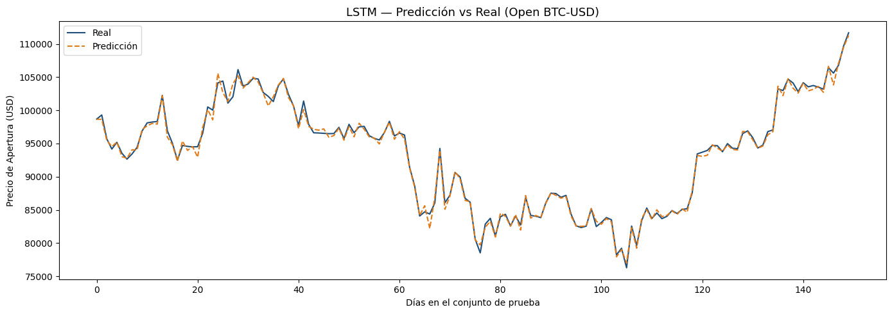
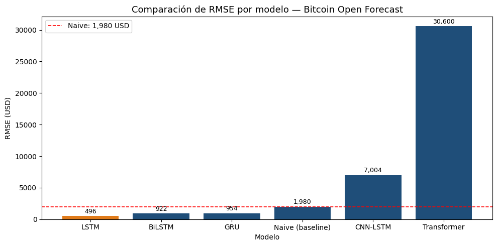

# Bitcoin Price Forecasting with Deep Learning

Benchmark of five neural architectures for one-day-ahead forecasting of Bitcoin's **opening price** (BTC-USD, daily data from Yahoo Finance, 2015 – Sep 2026), against a naive forecast.

> 🇪🇸 *Pronóstico del precio de apertura de Bitcoin con LSTM, GRU, BiLSTM, CNN-LSTM y Transformer, comparados con un pronóstico ingenuo. El notebook está en español.*



## Results (test set, USD)

| Model | RMSE | MAE | MAPE | Train time (s) |
|---|---:|---:|---:|---:|
| **LSTM** | **495.86** | **345.35** | **0.37 %** | 112.6 |
| BiLSTM | 922.24 | 704.69 | 0.72 % | 154.2 |
| GRU | 954.17 | 726.81 | 0.72 % | 75.6 |
| Naive (tomorrow = today) | 1,979.79 | 1,410.51 | 1.61 % | — |
| CNN-LSTM | 7,003.58 | 5,448.40 | 5.42 % | 38.1 |
| Transformer | 30,599.66 | 26,321.56 | 27.12 % | 96.8 |

- The **LSTM cuts RMSE by 75 %** versus the naive baseline.
- Only the three recurrent models beat the baseline. The CNN-LSTM and the Transformer did worse than naive: more complex architectures did not help on a short series with only OHLC inputs.
- Tuning mattered: going from 64 to 128 units, batch size 32 → 16 and a longer early-stopping patience moved the LSTM from below the baseline to the best model.



## Setup

| Item | Value |
|---|---|
| Inputs | `Close`, `High`, `Low`, `Open` (MinMax-scaled, scaler fit on train only) |
| Target | next-day `Open` |
| Window / horizon | 60 days / 1 day |
| Split | chronological 70 / 15 / 15 |
| Training | Adam, early stopping (patience 15), ReduceLROnPlateau (factor 0.5, patience 8), model checkpointing |
| Metric | RMSE in USD after inverse-scaling, plus MAE and MAPE |

## How to run

```bash
pip install -r requirements.txt
jupyter notebook bitcoin_price_forecasting.ipynb
```

Data are downloaded with `yfinance` at run time; some corporate networks block Yahoo Finance.

## Limitations and next steps

A single chronological split; walk-forward validation would give a more robust estimate. Only price variables were used; volume, on-chain or sentiment features could add signal. Low RMSE on a one-day horizon largely reflects price persistence, so the naive comparison is the meaningful one.

## Stack

Python · TensorFlow / Keras · scikit-learn · pandas · yfinance · matplotlib

**Author:** Mateo Aranguren
